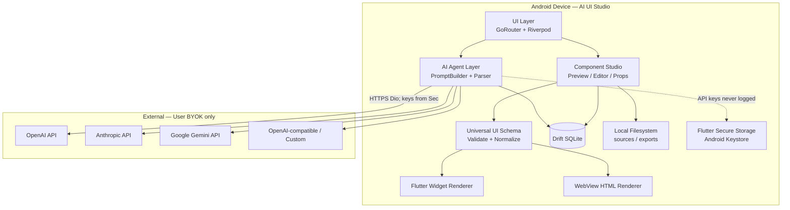
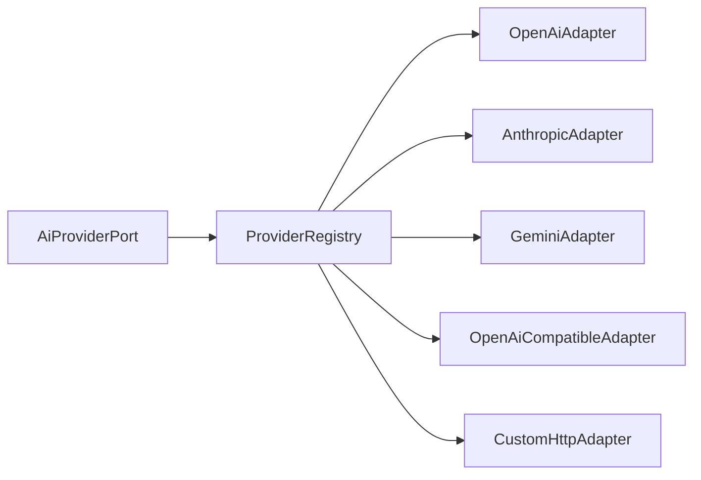
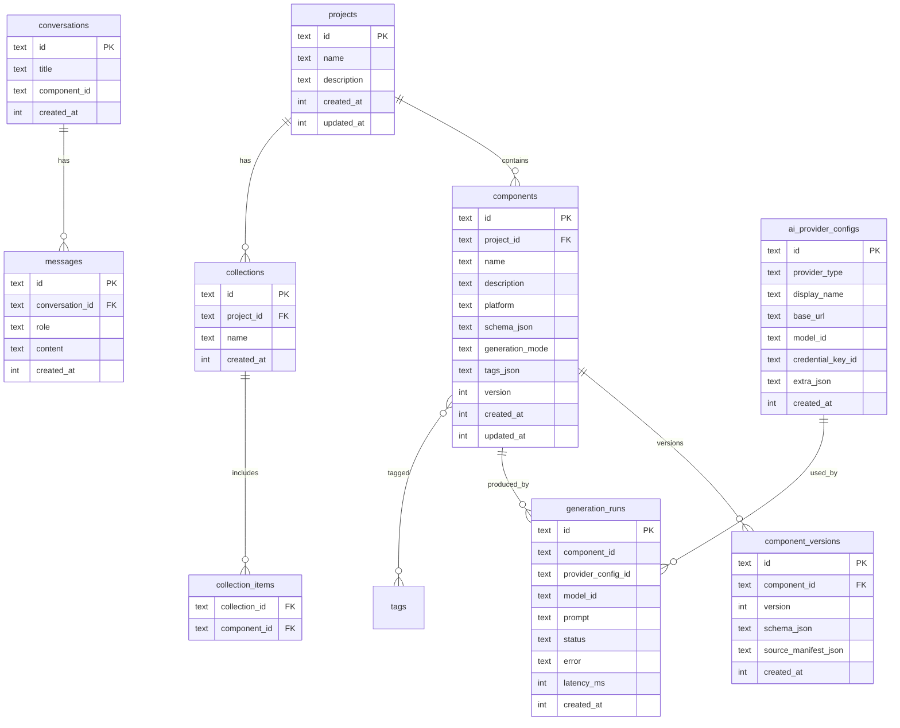
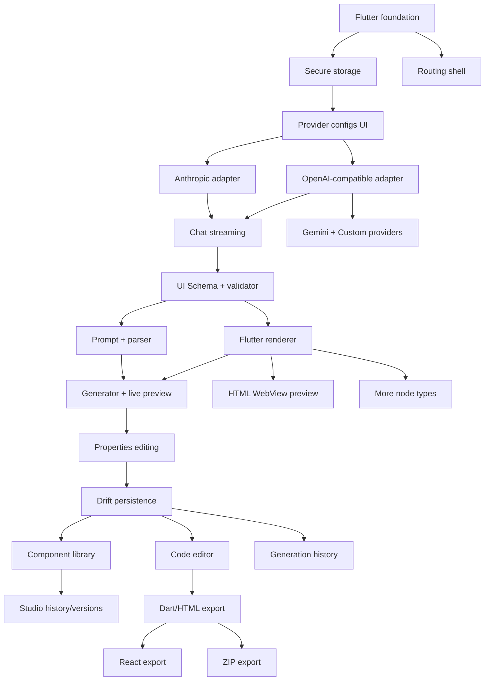

# AI UI Studio — Implementation Plan

**Status:** Full MVP implemented (schema, renderer, studio, library, export, CI APK)  
**Target:** Standalone Flutter Android app (BYOK, no custom backend)  
**Repository state (2026-10-31):** MVP complete — see `docs/MVP_STATUS.md`  
**Document version:** 2.0

### Approved product decisions (2026-10-31)

| Topic | Decision |
|-------|----------|
| applicationId | `com.aiuistudio.app` |
| Display name | AI UI Studio |
| OpenAI API | Chat Completions for v1; Responses API later via extensible adapters |
| Custom base URLs | Non-HTTPS only with explicit opt-in + warning; HTTPS default |
| Phase 2 scope | Flutter UI generation only (HTML/React later) |
| minSdk | 23 |
| Freezed / codegen | Approved |

---

## 1. Executive Summary

AI UI Studio is a personal Android app that generates reusable UI components via the user’s own AI API keys. The app owns prompting, schema validation, Flutter preview rendering, local persistence, editing, and export. Only model inference leaves the device.

**Core design principles**

1. **Local-first** — SQLite + secure key storage + filesystem; no app-owned backend.
2. **Schema-first preview** — Flutter live preview maps a Universal UI Schema to a fixed Widget Renderer. Never execute AI-generated Dart.
3. **Dual artifact generation** — Schema JSON (preview/edit) + native source (export). Complex UIs may be source-only.
4. **Provider adapters** — Each AI vendor is an independent adapter behind a shared interface.
5. **Pragmatic clean architecture** — Feature folders + clear domain/data boundaries without over-layering.

---

## 2. Current Repository State

| Item | Finding |
|------|---------|
| Git | Initialized, no commits |
| Flutter project | Not created |
| `lib/`, `android/`, `pubspec.yaml` | Absent |
| Docs | This plan only |

**Implication:** Phase 1 starts with `flutter create` (Android-focused; keep iOS folder optional/minimal). All package versions below are recommendations to lock at `flutter create` / first `pub get` time against pub.dev.

---

## 3. Architecture Overview

### 3.1 Layers (lightweight clean architecture)

```
Presentation (features/* screens + Riverpod UI state)
        ↓
Application / Use cases (generators, studio actions, export orchestration)
        ↓
Domain (entities, repository interfaces, schema models, AI port)
        ↓
Data (Drift DAOs, secure storage, Dio clients, file/ZIP export, provider adapters)
```

Avoid deep nesting and “enterprise” ceremony. Prefer:

- One repository interface per aggregate (Components, Projects, ProvidersConfig, Conversations).
- Providers as Riverpod `Notifier` / `AsyncNotifier` wiring repositories to UI.
- No global service locator beyond Riverpod.

### 3.2 Runtime data flow (generation)

```
User prompt + platform + style prefs
  → PromptBuilder (system + schema contract + few-shot)
  → AiProviderPort.streamChat / generateStructured
  → ResponseParser (JSON envelope: schema + code + metadata)
  → UiSchemaValidator
  → FlutterWidgetRenderer (preview) | WebView (HTML)
  → ComponentRepository.save (+ file write for source)
```

### 3.3 System architecture diagram



### 3.4 Provider adapter diagram



---

## 4. Proposed Folder Structure

Refines the suggested layout: keep `features/` for UI, put domain/data under `core/` and dedicated packages-style folders without creating multiple Dart packages in MVP.

```
lib/
  main.dart
  app/
    app.dart                 # MaterialApp.router + ProviderScope
    router.dart              # GoRouter routes
    theme.dart
    bootstrap.dart           # init DB, secure storage, logging
  core/
    constants/
    errors/                  # Failure types, Result helpers
    logging/                 # Redacting logger (strip Authorization / api_key)
    utils/
  domain/
    entities/
    repositories/            # abstract interfaces
    value_objects/
  data/
    database/                # Drift tables, DAOs, AppDatabase
    storage/                 # SecureKeyStore, FileStore, PathService
    export/                  # ZipExporter, FileExporter
    mappers/
  ai/
    ports/
      ai_provider_port.dart
      ai_models.dart         # ChatMessage, StreamChunk, GenerationRequest
    providers/               # concrete adapters
      openai_adapter.dart
      anthropic_adapter.dart
      gemini_adapter.dart
      openai_compatible_adapter.dart
      custom_http_adapter.dart
    registry/
      provider_registry.dart
    agent/
      prompt_builder.dart
      response_parser.dart
      generation_service.dart
    dio/
      ai_dio_factory.dart    # timeouts, redacting interceptors
  schema/
    models/                  # UiDocument, UiNode sealed types
    universal_ui.schema.json # JSON Schema draft
    validator.dart
    normalizer.dart
    codegen/                 # schema → platform source (later phases)
  renderers/
    flutter_renderer/
      widget_renderer.dart
      node_builders/         # button, card, text_field, layout, ...
      style_mapper.dart
      animation_mapper.dart
    web_renderer/
      html_preview.dart      # WebView + local HTML bundle
  features/
    home/
    generator/               # chat + generate flow
    projects/
    components/              # library / collections
    studio/                  # detail: preview + props + code tabs
    preview/
    editor/
    settings/                # providers, keys, models
  shared/
    widgets/
    extensions/
```

**Notes**

- `adapters/` from the original proposal is folded into `ai/providers/` to avoid duplicate concepts.
- `database/` and `storage/` live under `data/` for clear data-layer ownership.
- Platform codegen can start as templates in `schema/codegen/` then move if it grows.

---

## 5. Package and Dependency List

### 5.1 Recommended stack

| Concern | Package | Rationale |
|---------|---------|-----------|
| Framework | Flutter stable (3.24+) | Android-first; pin SDK in `pubspec` environment |
| State | `flutter_riverpod` + `riverpod_annotation` | Compile-safe DI/state; testable; widely maintained |
| Codegen | `riverpod_generator`, `build_runner`, `freezed`, `json_serializable` | Immutable models + JSON for schema/API DTOs |
| Routing | `go_router` | Declarative routes, deep links later |
| HTTP | `dio` | Interceptors, cancel tokens, streaming |
| DB | `drift`, `drift_flutter`, `sqlite3_flutter_libs` | Type-safe SQLite, migrations, streams |
| Secrets | `flutter_secure_storage` ^10+/^11 | Android Keystore-backed; min SDK 23 with v10+ cipher defaults |
| Paths | `path_provider`, `path` | App documents/cache |
| ZIP | `archive` | Collection export |
| Schema validation | `json_schema` | Mature Draft-7+ validator; validate AI output |
| HTML preview | `webview_flutter` | Local HTML/CSS/JS preview |
| Code editor (MVP) | `re_editor` + `re_highlight` | Lightweight, maintained, multi-language highlight; good mobile fit |
| UUID | `uuid` | Entity IDs |
| Clipboard / share | `share_plus` | Export/share files |
| Permissions | none for MVP | Files via app sandbox + share sheet |
| Logging | `logger` + custom redactor | Never print keys |
| Equatable / freezed | `freezed` | Prefer freezed for unions (UiNode types) |

### 5.2 Explicitly deferred / rejected for MVP

| Package | Decision |
|---------|----------|
| `code_forge` | Powerful but heavy; revisit if editor needs grow |
| `flutter_monaco_editor` | WebView-based; heavier; optional later |
| `code_text_field` / old `flutter_highlight` | Stale dependency chain |
| `firebase_*` | Conflicts with no-backend / privacy BYOK model |
| Dynamic Dart eval / JIT | **Forbidden** for preview |
| `http` alone | Prefer Dio for streaming + interceptors |
| Bloc | Riverpod sufficient; avoid dual state systems |

### 5.3 Android constraints

- **minSdk:** 23+ (align with `flutter_secure_storage` v10+).
- Cleartext traffic: disabled; HTTPS only to AI endpoints.
- Network security config: default system trust; optional user-pinned custom base URL still over TLS.
- ProGuard/R8: keep Drift / Secure Storage rules when enabling minify (Phase 4+).

### 5.4 Version pinning policy

At Phase 1 kickoff: resolve latest compatible versions with `flutter pub outdated`, then pin caret ranges. Re-verify Riverpod 2.x vs 3.x migration notes before locking generators.

---

## 6. AI Provider Integration Design

### 6.1 Port interface (conceptual)

```dart
abstract class AiProviderPort {
  String get id;           // openai | anthropic | gemini | openai_compatible | custom
  String get displayName;
  Future<List<AiModelInfo>> listModels(); // static catalog + optional remote
  Stream<AiStreamChunk> streamChat(AiChatRequest request);
  Future<AiChatResponse> chat(AiChatRequest request);
  // Optional capabilities:
  bool get supportsStreaming;
  bool get supportsJsonSchema;   // structured output / response_format
  bool get supportsTools;        // not required for MVP generation
}
```

### 6.2 Request / response models

- `AiChatRequest`: `messages`, `model`, `temperature`, `maxTokens`, `responseFormat` (text | json_object | json_schema), `abortSignal` (CancelToken).
- `AiStreamChunk`: `deltaText`, `finishReason`, optional `usage`.
- Credentials injected via `ProviderCredentials` resolved from Secure Storage by `credentialRef` — **never** stored on the request object in logs.

### 6.3 Adapter responsibilities

| Adapter | Auth | Streaming | Structured JSON | Notes |
|---------|------|-----------|-----------------|-------|
| OpenAI | Bearer | SSE | `response_format` | Chat Completions and/or Responses API — pick one and document |
| Anthropic | `x-api-key` + version header | SSE | Prefer tool/JSON prompting; parse carefully | Message API differs from OpenAI |
| Gemini | API key query/header | StreamGenerateContent | JSON mime / schema where supported | Different payload shape |
| OpenAI-compatible | Bearer + custom baseUrl | SSE if available | Best-effort | Groq, Together, local gateways |
| Custom | User-defined headers/body template (Phase 4) | Optional | Prompt-enforced JSON | Minimal HTTP POST mapping |

### 6.4 Credential storage

- Drift stores **provider config metadata only**: id, name, baseUrl, selectedModel, `credentialKeyId`, createdAt.
- Secure storage key pattern: `ai_cred_<uuid>`.
- Values: raw API key string (or JSON blob for multi-field custom auth).
- Redacting Dio interceptor strips `Authorization`, `x-api-key`, `api-key`, query `key`.
- UI never mirrors full key after save (show last 4 only).

### 6.5 Generation contract (envelope)

AI is instructed to return JSON:

```json
{
  "componentName": "PrimaryButton",
  "description": "...",
  "platform": "flutter",
  "schema": { "$schemaVersion": "1.0", "root": { } },
  "source": { "language": "dart", "files": [{ "path": "primary_button.dart", "content": "..." }] },
  "tags": ["button", "material"],
  "warnings": []
}
```

If schema cannot represent the UI: `"schema": null` and `source` required (`generationMode: "source_only"`).

---

## 7. Universal UI Schema Design

### 7.1 Goals

- Platform-agnostic tree of nodes + style tokens.
- Extensible via `type` string + `props` + `children` + `style` + `actions`.
- Versioned (`$schemaVersion`).
- Validated with `json_schema` before render.

### 7.2 Core types (MVP → expand)

**Node types Phase 2:** `column`, `row`, `stack`, `padding`, `center`, `expanded`, `text`, `button`, `card`, `textField`, `sizedBox`, `spacer`, `image` (asset/network URL optional later).

**Phase 3+:** `list`, `listTile`, `appBar`, `dialog`, `scaffold`, `icon`, `divider`, `container`, `gradientBox`, `animatedOpacity`, `inkWell`.

### 7.3 Style object

```json
{
  "padding": { "all": 16 },
  "margin": { "horizontal": 8 },
  "alignment": "center",
  "mainAxisAlignment": "spaceBetween",
  "crossAxisAlignment": "start",
  "gap": 12,
  "width": 200,
  "height": null,
  "minWidth": null,
  "decoration": {
    "color": "#FF6200EE",
    "borderRadius": 12,
    "border": { "color": "#1F000000", "width": 1 },
    "boxShadow": [{ "color": "#33000000", "blur": 8, "offset": { "x": 0, "y": 4 } }],
    "gradient": {
      "type": "linear",
      "begin": "topLeft",
      "end": "bottomRight",
      "colors": ["#FF7C4DFF", "#FF18FFFF"]
    }
  },
  "textStyle": {
    "fontSize": 16,
    "fontWeight": "w600",
    "color": "#FF000000",
    "letterSpacing": 0.2
  }
}
```

Colors: ARGB hex `#AARRGGBB` or `#RRGGBB` (normalizer expands).

### 7.4 Interactions (preview-safe)

```json
{
  "actions": {
    "onPressed": { "type": "previewToast", "message": "Clicked" },
    "onChanged": { "type": "noop" }
  }
}
```

Preview actions are sandboxed (toast / debug log / local state bind). Export codegen maps `onPressed` to platform callbacks stubs.

### 7.5 Example — Button in Card

```json
{
  "$schemaVersion": "1.0",
  "id": "promo_card",
  "root": {
    "type": "card",
    "props": { "elevation": 2 },
    "style": {
      "padding": { "all": 16 },
      "decoration": { "borderRadius": 16, "color": "#FFFFFFFF" }
    },
    "children": [
      {
        "type": "column",
        "style": { "gap": 12, "crossAxisAlignment": "stretch" },
        "children": [
          {
            "type": "text",
            "props": { "data": "Upgrade plan" },
            "style": { "textStyle": { "fontSize": 20, "fontWeight": "w700" } }
          },
          {
            "type": "text",
            "props": { "data": "Unlock unlimited generations." },
            "style": { "textStyle": { "fontSize": 14, "color": "#99000000" } }
          },
          {
            "type": "button",
            "props": { "label": "Continue", "variant": "filled" },
            "actions": { "onPressed": { "type": "previewToast", "message": "Continue" } }
          }
        ]
      }
    ]
  }
}
```

### 7.6 Extensibility

- Unknown `type`: render as outlined placeholder box with type name (do not crash).
- `extensions` map on document/node for future props.
- Schema registry maps type → builder; new builders register without breaking old documents.

### 7.7 Schema vs source-only

| Case | Schema | Source |
|------|--------|--------|
| Simple Button/Card/Input | Required | Required |
| Custom painter / complex animation | Optional null | Required |
| HTML page | Optional simplified tree OR null | Required HTML/CSS/JS files |
| React | Schema optional for later preview | Required JSX from Phase 4 |

---

## 8. Flutter Widget Renderer Design

### 8.1 Rules

1. **Only** render validated/normalized `UiDocument`.
2. **Never** `Isolate`/`eval`/compile AI Dart.
3. Builders are pure functions: `Widget build(UiNode node, RenderContext ctx)`.
4. `RenderContext` holds theme defaults, interaction handlers, density, preview mode flags.
5. Property edits in Studio mutate schema JSON → re-validate → rebuild (Riverpod state).

### 8.2 Pipeline

```
JSON string → jsonDecode → UiSchemaValidator → Normalizer → UiDocument
  → WidgetRenderer.build(document.root)
```

### 8.3 Node builder map

```dart
final builders = <String, NodeBuilder>{
  'column': ColumnBuilder(),
  'row': RowBuilder(),
  'card': CardBuilder(),
  'button': ButtonBuilder(),
  'textField': TextFieldBuilder(),
  'text': TextBuilder(),
  // ...
};
```

Nested layouts: recursive `buildChild`. Unsupported nodes: `UnsupportedNodeWidget`.

### 8.4 Styling mapping

- Map `decoration` → `BoxDecoration` / `Card` theme.
- Map flex props → `MainAxisAlignment` enums with safe defaults.
- Animations (Phase 2 light / Phase 3): wrap with `AnimatedOpacity` / `AnimatedContainer` when `animation` block present; keep declarative and time-bounded.

### 8.5 Interactivity

- Buttons/`InkWell`: wire to preview action dispatcher.
- Text fields: local `TextEditingController` cache keyed by node id (dispose on document change).
- No navigation outside preview sandbox in MVP.

### 8.6 HTML preview

- `webview_flutter` loads `Uri.dataFromString` or file:// under app documents.
- React live preview: **out of MVP**; export only until a later phase (e.g. bundled JS runtime).

### 8.7 Performance

- Cap tree depth / node count (e.g. 200 nodes) with validation error.
- Use `RepaintBoundary` around preview root.
- Debounce property edits (150–300 ms) before rebuild.

---

## 9. Database Schema (Drift / SQLite)

API keys **must not** appear in these tables.

### 9.1 ER overview



### 9.2 Filesystem layout

```
{appDocuments}/ai_ui_studio/
  components/{componentId}/v{n}/
    schema.json
    source/...
  exports/{timestamp}_{name}.zip
```

Drift stores paths/manifests; large source blobs preferably on disk with DB pointing to relative paths (keeps SQLite lean). For MVP small components, storing source in `component_versions.source_manifest_json` inline is acceptable; migrate to files when size grows.

### 9.3 Migrations

- Drift schema version starting at 1.
- Every phase that adds tables bumps version with explicit migration.

---

## 10. Domain Models (app-facing)

- `Project`, `UiComponent`, `ComponentVersion`, `Collection`
- `AiProviderConfig` (no secret fields)
- `Conversation`, `ChatMessage`
- `GenerationRun`
- `ExportBundle`

`UiComponent` fields: name, description, platform (`flutter`|`react`|`html`), schema, source files, preview mode, createdAt, tags, version.

---

## 11. UI Screen Specifications & Navigation

### 11.1 Routes (`go_router`)

| Path | Screen | Purpose |
|------|--------|---------|
| `/` | Home | Recent components, CTAs: Generate / Library / Settings |
| `/generate` | Generator | Prompt, platform, provider/model, stream output |
| `/components` | Library | Search, tags, collections |
| `/components/:id` | Studio | Tabs: Preview / Properties / Code / History |
| `/projects` | Projects | List/create projects |
| `/projects/:id` | Project detail | Components in project |
| `/settings` | Settings | Providers & keys |
| `/settings/providers` | Provider list | Add/edit providers |
| `/settings/providers/:id` | Provider edit | Model, base URL, key |
| `/editor/:componentId` | Fullscreen editor | Optional from Studio |

### 11.2 Key user flows

**A. First-run**

1. Home empty state → “Add AI Provider”.
2. Choose type → paste API key → test connection (cheap models.list or tiny chat).
3. Return Home → “Generate component”.

**B. Generate**

1. Select platform + provider/model.
2. Enter natural language prompt (+ optional constraints).
3. Stream assistant output; parse final JSON envelope.
4. Show preview if schema valid; else show source + warning.
5. Save to library / project.

**C. Studio edit**

1. Open component → Preview.
2. Properties panel edits mapped schema fields → live preview.
3. Code tab edits source (does not auto-sync schema).
4. Regenerate with same/new prompt.
5. Export / copy / duplicate / delete.

**D. Export**

1. Single file share or multi-file ZIP with `README_USAGE.md` template.

### 11.3 MVP UI simplicity

- Material 3, readable density for phones.
- Bottom nav or NavigationRail-less: Home, Generate, Library, Settings.
- Avoid dashboard clutter; one primary action per screen.

---

## 12. Export System

| Platform | Artifacts |
|----------|-----------|
| Flutter | `*.dart` + short usage snippet (wrap in app) |
| HTML | `index.html`, `styles.css`, `script.js` as applicable |
| React | `.jsx` / `.tsx` (export-only MVP) |
| Collection | ZIP of selected components + root README |

Generated code must be copy-paste reusable (no app-specific runtime imports).

---

## 13. MVP Milestones & Phases

### Phase 1 — Foundation & AI chat  
**Goal:** Runnable Android app, settings, BYOK, chat with streaming.

- Flutter create + folder skeleton + theme + GoRouter shell.
- Secure storage + provider config CRUD (metadata in memory or Drift light).
- OpenAI-compatible + Anthropic adapters.
- Basic chat UI (not yet UI generation).
- Redacting logger + connection test.

**Exit criteria:** User can save a key and stream a chat reply on device.

### Phase 2 — Schema + Flutter renderer + generate UI  
**Goal:** Prompt → schema+code → live Flutter preview for Button/Card/Input.

- Universal UI Schema v1 + validator.
- PromptBuilder for Flutter target.
- WidgetRenderer for MVP node set.
- Generator screen produces envelope; Studio preview tab.
- Property editing for core style props.

**Exit criteria:** Generate a Card+Button+TextField and see interactive preview.

### Phase 3 — Library, persistence, editor, export  
**Goal:** Local component library with Drift, editor, Dart/HTML export.

- Full Drift models + versions.
- Component library + collections.
- `re_editor` integration.
- HTML WebView preview + HTML/CSS export.
- Dart file export / share.

**Exit criteria:** Persist, reopen, edit code, export Dart and HTML.

### Phase 4 — React export, ZIP, more providers, hardening  
**Goal:** Expand platforms/providers and reliability.

- React/JSX generation + export (no live preview required).
- ZIP collection export.
- Gemini + Custom adapter.
- Generation history UI.
- Stronger validation, error recovery, golden tests for renderer.

**Exit criteria:** Multi-provider generations; ZIP export; history browsable.

---

## 14. Step-by-step Implementation Checklist

### Phase 1

1. Create Flutter project (`platforms: android`, org name TBD).
2. Add dependencies; configure `analysis_options.yaml`.
3. Scaffold folders; `bootstrap.dart` + Riverpod root.
4. Theme + shell scaffold with 4 destinations.
5. Implement `SecureKeyStore` wrapper.
6. Implement `AiProviderPort` + DTOs.
7. Implement OpenAI-compatible adapter (covers OpenAI + compatible).
8. Implement Anthropic adapter.
9. Provider settings UI + test connection.
10. Chat screen with streaming + cancel.
11. Unit tests: redaction, credential round-trip (mocked storage).
12. Manual device/emulator test checklist.

### Phase 2

1. Author `universal_ui.schema.json` + Dart models (freezed).
2. Validator + normalizer + unknown-node policy.
3. Node builders: layout + text + button + card + textField.
4. `WidgetRenderer` + Preview widget.
5. Prompt templates + response parser + repair prompt on invalid JSON.
6. Wire Generator → Preview.
7. Properties panel (selected node path).
8. Widget tests for renderer golden/smoke.
9. Integration test: mock AI → preview renders.

### Phase 3

1. Drift tables + DAOs + migrations.
2. FileStore for sources.
3. Components library UI + search/tags.
4. Studio tabs + version snapshot on save/regenerate.
5. `re_editor` for dart/html/css/js/json.
6. HTML renderer via WebView.
7. Export services + share sheet.
8. DAO/repository tests; export zip smoke test.

### Phase 4

1. Gemini adapter.
2. Custom endpoint adapter (headers map).
3. React prompt pack + JSX export.
4. ZIP multi-component export + README templates.
5. Generation history screens.
6. Hardening: retries, timeouts UX, schema drift warnings.
7. Expand renderer node coverage (list, dialog, appBar).
8. Performance pass on large schemas.

---

## 15. Task Dependencies



---

## 16. Testing Strategy

### Cross-cutting

- **Unit:** parsers, validators, style mappers, redacting logger, prompt builder.
- **Widget:** renderer trees, settings forms, studio tabs.
- **Golden (optional Phase 2+):** button/card/input fixtures.
- **Integration:** mock `AiProviderPort` → save component → reload from DB.
- **Manual:** real keys against OpenAI/Anthropic on a physical device before phase exit.
- **Security checks:** confirm keys absent from Drift DB file and logcat.

### Per phase

| Phase | Must-pass tests |
|-------|-----------------|
| 1 | Adapter request shaping (no key in toString); stream chunk parse; secure write/read mock |
| 2 | Schema validate accept/reject; renderer builds MVP fixtures; invalid JSON recovery path |
| 3 | CRUD components; version increment; export file contents; editor load/save |
| 4 | ZIP structure; React file present; provider registry resolves all types; history query |

### CI (when repo hosting exists)

`flutter analyze`, `flutter test`, optionally `flutter build apk` on PR. No secrets in CI — mocks only.

---

## 17. Security Considerations

1. API keys only in Keystore-backed secure storage.
2. Redact secrets in logs, crash reports, Dio interceptors, `toString`, screenshots of debug banners.
3. No analytics SDK in MVP that could exfiltrate prompts/keys.
4. TLS only; user-defined base URLs must be HTTPS (allow exception flag only for advanced/local with explicit warning — default deny cleartext).
5. WebView: disable arbitrary file access; load only app-generated HTML; JS enabled only for HTML preview sandbox.
6. Exported ZIPs must not include API keys or chat transcripts with secrets.
7. Clipboard: copying source is fine; never auto-copy keys.
8. Backup: recommend excluding secure storage from insecure backups where configurable.

---

## 18. Known Limitations

1. **No dynamic Dart execution** — preview coverage ≤ renderer capability.
2. **Schema expressiveness gap** — complex custom UIs are source-only; Flutter preview may show placeholder.
3. **React live preview deferred** — export-only initially.
4. **Provider feature parity** — structured outputs differ; fallback to prompt-enforced JSON.
5. **Mobile editor** — not IDE-grade (no full LSP analysis in MVP).
6. **Offline** — browsing library works offline; generation requires network.
7. **Model drift** — models may return invalid JSON; need repair loop / user fix.
8. **Android-first** — iOS may work later but is not a Phase 1 commitment.
9. **Token cost** — BYOK means user bears cost; app should show model name and warn on large contexts.
10. **Empty repo** — no legacy constraints, but all tooling must be bootstrapped.

---

## 19. Risks & Mitigations

| Risk | Impact | Mitigation |
|------|--------|------------|
| AI returns invalid/non-schema JSON | Broken preview | Strict parser + repair re-prompt + source-only fallback |
| Anthropic/OpenAI API shape changes | Adapter break | Isolate adapters; contract tests with recorded fixtures |
| `flutter_secure_storage` Android cipher migration | Key loss on upgrade | Document version; enable migrate flags; backup guidance |
| Renderer scope creep | Delay MVP | Hard-cap Phase 2 node list |
| Over-abstraction | Slow delivery | No multi-package monorepo in MVP |
| WebView inconsistencies | HTML preview bugs | Prefer file-based load; test on API 26+ and 34 |
| Prompt injection in model output | Unexpected UI | Validate schema; sandbox actions; no OS intents from schema |
| Large components in SQLite | Perf issues | Move sources to filesystem early if needed |

---

## 20. Future Improvements (post-MVP)

- React/JS preview via embedded JS engine or local bundler.
- Design-system tokens / theme packs.
- Figma-like visual tree inspector.
- Multi-file Flutter component packages.
- On-device small models (optional) for offline draft prompts.
- Component marketplace import/export formats.
- iOS / desktop targets.
- Visual regression CI goldens.
- User-defined schema node plugins.

---

## 21. Complexity Estimates (rough)

| Phase | Effort (1 engineer) | Complexity |
|-------|---------------------|------------|
| 1 | 1–2 weeks | Medium |
| 2 | 2–3 weeks | High (schema + renderer + prompts) |
| 3 | 2 weeks | Medium–High |
| 4 | 1.5–2 weeks | Medium |

Order is fixed by dependencies in §15. Do not start Phase 2 renderer before Phase 1 adapters stabilize.

---

## 22. Architecture Evaluation vs Original Proposal

| Proposal item | Decision |
|---------------|----------|
| Folder `lib/app/core/ai/...` | Adopted with `domain/` + `data/` clarification |
| `adapters/` sibling to `providers/` | Merged into `ai/providers` |
| Riverpod + GoRouter + Dio + Drift | Adopted |
| Flutter Secure Storage | Adopted (minSdk 23+) |
| JSON Schema validation | `json_schema` |
| Flutter code editor | `re_editor` (+ `re_highlight`) for MVP |
| Widget Renderer for Flutter preview | Adopted — non-negotiable safety boundary |
| WebView for HTML | Adopted |
| React preview | Explicitly later |
| Clean architecture | Lightweight — interfaces at domain boundary only |

---

## 23. Open Decisions for Product Owner

See approval gate questions in the companion summary presented after this document. Critical ones:

1. Application ID / package name and display name finalization.
2. Default AI target for first generator demos (Flutter-only until Phase 3 HTML?).
3. OpenAI API surface: Chat Completions vs Responses API.
4. Whether custom/local HTTP cleartext is ever allowed.
5. Theme direction (Material 3 defaults vs branded palette).
6. Minimum Android version tradeoff if supporting devices below API 23 (not recommended).

---

## 24. Approval Gate / MVP completion

Plan approved 2026-10-31. The product owner later requested a complete MVP without further phase gates.

MVP delivery notes: `docs/MVP_STATUS.md`  
APK / CI notes: `docs/GITHUB_ACTIONS_APK.md`

---

*End of plan.*
